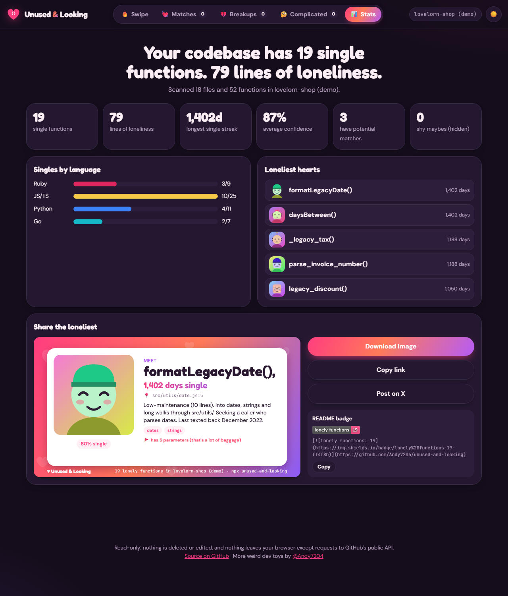
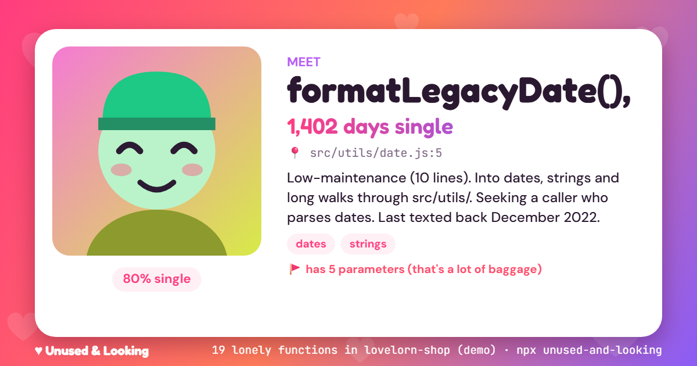

# Unused & Looking 💔

**Your codebase is full of lonely functions. Help them find love (or delete them).**

[](https://github.com/Andy7204/unused-and-looking/actions/workflows/ci.yml)
[](https://www.npmjs.com/package/unused-and-looking)
[](LICENSE)
[](https://andy7204.github.io/unused-and-looking/)


<!-- Replace with docs/demo.gif — see LAUNCH.md -->

## Try it

**In the browser:** [andy7204.github.io/unused-and-looking](https://andy7204.github.io/unused-and-looking/). Paste a public GitHub repo, pick a local folder, or open the demo.

**In your terminal** (no install, Node 18+):

```bash
npx unused-and-looking
```

## What it does

- 🔍 **Finds functions nobody calls** in JS/TS/JSX/TSX, Python, Go and Ruby. It also finds things that are exported but never imported.
- 💘 **Gives each one a dating profile**: a generated avatar, "name, age" (days since it was last touched), a bio, interests and red flags ("has 5 parameters", "uses var").
- 👉 **Swipe right to see its matches**: duplicated logic elsewhere, call sites of similarly named functions, and inline code doing the same job. Each match has a compatibility %.
- 👈 **Swipe left to add it to the Breakup List.** Export the list as Markdown, ready for a cleanup PR. ⬆️ Swipe up for "It's complicated".
- 🎯 **Built not to embarrass you.** Framework entry points, lifecycle hooks, decorators, test functions and dynamic calls count as alive. Every orphan gets a confidence score with the reasons behind it.
- 🙅 **Read-only.** It never deletes or edits a line of code. It only makes lists.

## Gallery

| Swipe (light) | Stats & sharing |
| --- | --- |
|  |  |

| The share card | On your phone |
| --- | --- |
|  |  |

The CLI tells the same story:

```text
♥ Unused & Looking · scanned 18 files in the demo repo (lovelorn-shop)

  1. _legacy_tax()  · 1,188 days single  · 95% sure
     services/billing/invoice.py:15 · 5 params · 9 lines
     "5 params, 9 lines. Likes: money, math. Looking for: someone who is good with money. Ghosted since July 2023."
     🚩 has 5 parameters (that's a lot of baggage) · bare except: · hasn't changed in 3 years

  Your codebase has 19 single functions. 79 lines of loneliness.
  Loneliest: formatLegacyDate(), 1,402 days single
```

Put your number in your README (the CLI prints yours):

[](https://github.com/Andy7204/unused-and-looking)

```md
[](https://github.com/Andy7204/unused-and-looking)
```

## How it works

One small analyser (`src/core/`, zero dependencies) runs both in Node and in the browser:

1. **Strip** comments and string contents from every file, keeping line numbers. Code inside `${}`, `f"{}"` and `"#{}"` stays, because it really runs.
2. **Find definitions** with language-aware regexes: top-level functions, arrow consts, class methods, `def`, `func`, Ruby `private` sections and so on.
3. **Count references** to each name everywhere else. A function's own body (recursion) and export lists don't count.
4. **Keep things alive that frameworks call for you**: JSX components, Next.js/Remix/SvelteKit route exports, React lifecycles, Python dunders and decorators, `pytest` and Go test functions, Go `main`/`init` and interface methods, Rails controller actions, entry points in `pyproject.toml`/`package.json`, and names used in HTML/ERB/Vue templates.
5. **Score confidence** from 95% down. Penalties apply for being exported, being a method, inheriting from an external class, a name mentioned in a string or config file, a name built at runtime (`` this[`voice_${x}`] ``), or being part of a published library's public API. Only orphans at ≥50% show by default. The rest are "shy maybes".
6. **Matchmake** with normalised token shingles (local names become `v`, APIs like `.padStart` stay), similar-name call sites, and API + keyword overlap on single lines.
7. **Ages** come from `git blame` on the function's own lines (CLI), commit dates from the GitHub API (web), or file modified times (folder picker).

**Privacy:** there is no backend, no analytics and no tracking. The CLI reads files and runs `git blame` locally. The web app analyses everything in your browser. It only talks to `api.github.com` (1 call for the file tree, plus a few for ages) and `raw.githubusercontent.com` (file contents), and only for repos you ask it to read. An optional token stays in your browser and only goes to `api.github.com`. Swipe decisions are saved in your browser's localStorage.

**How accurate is it?** On 12 real open-source repos plus 4 local projects, the final version flagged 6 functions at ≥50% confidence. A `git grep` confirmed all 6 are unused. Well-maintained libraries mostly come out as "maybe" or "happily married". That is deliberate: a false positive is worse than a miss.

## Options

```bash
npx unused-and-looking [dir] [options]
```

| Flag | What it does |
| --- | --- |
| `--swipe` | Open the swipe UI in your browser with these results (local server, localhost only) |
| `--json` | Print the full report as JSON |
| `--markdown`, `--md` | Print every orphan as a Breakup List |
| `--min-confidence <n>` | Only show orphans at least this sure (default `50`) |
| `--limit <n>` | How many profiles to print (default `15`, `0` = all) |
| `--max <n>` | Exit with code 1 if there are more than `n` orphans (handy in CI) |
| `--no-git` | Don't use git; ages fall back to file modified time |
| `--demo` | Analyse the bundled demo repo |
| `--port <n>` | Port for `--swipe` (default `5186`) |
| `--no-open` | With `--swipe`, don't open a browser |
| `--no-color` | No colours (`NO_COLOR` is respected too) |

Web URL parameters: `?repo=owner/name`, `&ref=branch`, `&fn=functionName` (opens that profile), `?demo`.

It skips `node_modules`, `.git`, `vendor`, `venv`, `dist`, `build`, minified and generated files, and test fixtures. It respects `.gitignore` when run in a git repo.

## Contributing

Ideas welcome, especially **false-positive reports**: they make the tool better for everyone. New languages, framework rules and funnier bios are welcome too. See [CONTRIBUTING.md](CONTRIBUTING.md). Tests: `npm test`.

## License

[MIT](LICENSE) © 2026 Andy7204

---

More weird dev toys by [@Andy7204](https://github.com/Andy7204)
